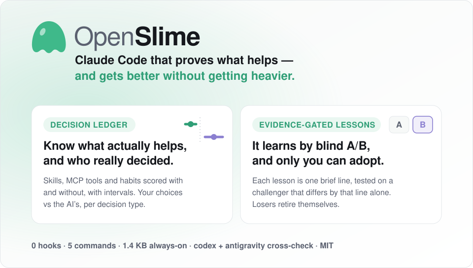
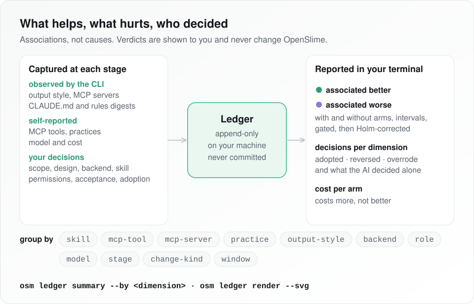
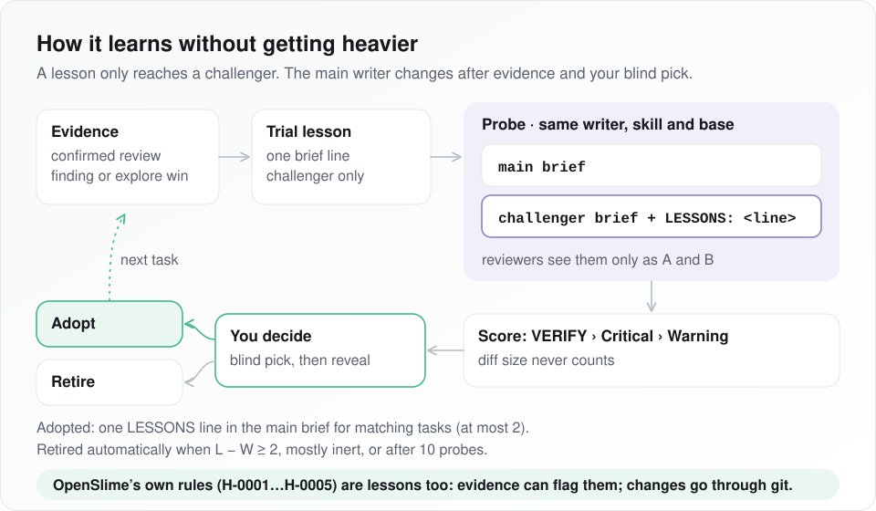
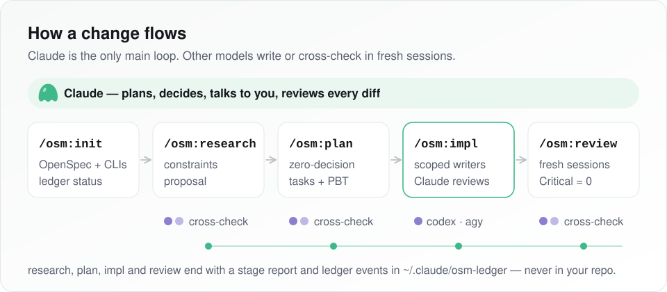
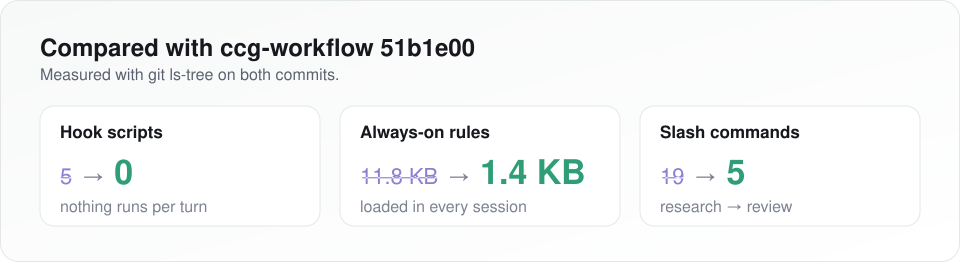

<p align="center">
  <picture>
    <source media="(prefers-color-scheme: dark)" srcset="assets/diagrams/hero-dark.svg">
    
  </picture>
</p>

<p align="center">
  
  
  
  
  
  
</p>

<p align="center"><sub>English &middot; <a href="README.zh-CN.md">简体中文</a></sub></p>

---

## Two core features

### ① Decision ledger: know what actually helps, and who really decided

Most agent setups pile on skills, MCP servers and habits on faith. OpenSlime keeps score.

- **With vs. without, per item.** Every skill, MCP tool or server, practice, backend, model, stage and change kind is split into runs *with* it and *without* it, and compared on later Critical findings, verify failures and accepted findings.
- **Verdicts you can trust.** "Associated better" or "worse" appears only with ≥10 samples from ≥5 runs on each side, a Newcombe interval that excludes zero, and Holm correction across everything tested. Otherwise it says *insufficient*, never a guess.
- **Cost on the same page.** Mean tokens and USD per side, with a plain flag: *costs more, not better*.
- **You vs. the AI.** For scope, design, backend, skill, permissions, acceptance and adoption: how often you adopted, overrode or were turned around, and how many calls the AI made alone. Recommendations sit at a run-hashed position, so "picked the first option" can't pass for "agreed".
- **Zero context cost.** It all runs in your own terminal, deterministic, no model calls: `osm ledger summary --by skill`, `--by decision`, `osm ledger render --svg`.

<p align="center">
  <picture>
    <source media="(prefers-color-scheme: dark)" srcset="assets/diagrams/dimensions-dark.svg">
    
  </picture>
</p>

### ② Evidence-gated lessons: it learns, but never gets heavier

Inspired by [Harness²](https://github.com/google-research/harness2), kept small.

- **One line, one variable.** A lesson is a single brief line. On trial it only reaches a challenger that is identical to the main writer except for that line.
- **Blind A/B.** Reviewers see two candidates as A and B. VERIFY first, then Criticals, then Warnings; diff size never counts.
- **You adopt, blind first.** You pick between the two diffs without knowing which had the lesson, then see the reveal. Nothing reaches the main brief without you.
- **Bad ideas retire themselves.** A lesson that loses is retired automatically. OpenSlime's own rules (H-0001…H-0005) are tracked the same way.

<p align="center">
  <picture>
    <source media="(prefers-color-scheme: dark)" srcset="assets/diagrams/lesson-loop-dark.svg">
    
  </picture>
</p>

> **Dogfooded.** While building this release, the ledger blind-tested a trial lesson, recorded a severe loss and retired it on its own. It also showed Claude's stated confidence running *below* reality (stated ~70%, while ~83% of those stages later passed review with no Critical), and that the human overrode 2 of 8 recommendations.

## Install

Paste this to your coding agent (Claude Code, Codex):

```text
Install OpenSlime from https://github.com/Overbaker/OpenSlime. Follow AGENTS.md in that repo, then run its doctor check and tell me the result.
```

Manual steps: [AGENTS.md](AGENTS.md).

## Five commands

| Command | What it does |
| --- | --- |
| `/osm:init` | Set up OpenSpec, check the model CLIs and the decision ledger. |
| `/osm:research` | Requirement &rarr; constraints + OpenSpec proposal. |
| `/osm:plan` | Zero-decision plan: specs, design, `tasks.md`. |
| `/osm:impl` | Hand each task to a writer; Claude reviews the diff. |
| `/osm:review` | Independent-session review before archive. |

## How it works

<p align="center">
  <picture>
    <source media="(prefers-color-scheme: dark)" srcset="assets/diagrams/workflow-dark.svg">
    
  </picture>
</p>

- **Scoped writers.** In `/osm:impl`, `codex` writes backend, logic and tests, and `antigravity` writes UI. Each task lists the files its writer may touch.
- **Claude supervises.** It fixes behaviour-preserving slips of &le;5 lines itself and re-runs `VERIFY`. Anything bigger goes back to the writer via `resume`; after two failed tries it asks you before taking over.
- **Always cross-checked.** Research, plan and review run codex and antigravity in separate fresh sessions, and Claude compares where they agree and where they don't.
- **Stage report.** Every run ends with a report in `${TMPDIR:-/tmp}/osm-reports/` that includes a confidence estimate (High/Medium/Low, %).

## Ledger reference

- **Decision ledger.**
  - Each stage appends one line to `~/.claude/osm-ledger/`. Recorded: the confidence it stated, the decisions you made, probe results, and what later reviews found.
  - The ledger stays out of your repo, and uninstall keeps it.
  - Nothing is recorded per turn and there are no hooks.
- **See it without spending context.** Run these in your own terminal:
  - `~/.claude/bin/osm ledger summary` shows each backend's or skill's contribution (keep / revisit / not enough data), confidence vs. later outcomes, and how often your choice matched, overrode or reversed the AI's recommendation, with a rubber-stamp warning.
  - `~/.claude/bin/osm ledger summary --by-harness` compares those numbers before and after each change to OpenSlime's own prompts or parameters.
  - `~/.claude/bin/osm ledger summary --by <dimension>` splits stages into with / without each skill, MCP tool or server, practice, output style, backend, role, model, stage, change kind or time window. An item is called associated better or worse only with enough runs on both sides and after Holm correction; mean cost per side is shown, and "costs more, not better" is flagged. Associations, not causes: nothing changes automatically.
  - `~/.claude/bin/osm ledger summary --by decision` shows, per decision dimension (scope, design, backend, skill, permissions, acceptance, adoption), how often you adopted, overrode or reversed the AI, and how many decisions the AI made alone. Recommendations are placed at a run-hashed position, so "picked the first option" can be told apart from "agreed".
  - `~/.claude/bin/osm ledger render --svg` writes a light and a dark SVG of that view under `~/.claude/osm-ledger/renders/`, with no change ids, topics or paths in it.

- **Lessons ([Harness²](https://github.com/google-research/harness2), kept small).**
  - A lesson is one line for a writer's brief, backed by evidence.
  - While on trial, it only reaches a challenger that is identical to the main writer except for that line. Both results are reviewed blind as A/B and scored on VERIFY, then Criticals, then Warnings; diff size never counts.
  - It reaches the main brief only after a blind pick and a reveal, both made by you.
  - Losing lessons retire on their own.
- **OpenSlime holds itself to the same rules.** Its confidence formula, probe budget, adoption bar and reviewer prompts are registered as adopted lessons (`osm ledger harness`). Evidence can flag them for revisit, and changing them is a normal reviewed change.
- **Opt out** with `~/.claude/bin/osm ledger off`, `OSM_LEDGER=0` or `--no-ledger`. Stages still finish, their confidence is unchanged, and lessons and probes are skipped.
- **Probes need committed code.** A probe starts only when the tree is clean apart from `openspec/`; otherwise the skip is recorded as `dirty-base`.
- **Flags.** `/osm:impl --compare` forces a lesson probe. `--compare explore` runs the old self-routing comparison, which is never credited to a lesson. `--no-probe` turns probes off.

## Why it is small

<p align="center">
  <picture>
    <source media="(prefers-color-scheme: dark)" srcset="assets/diagrams/compare-dark.svg">
    
  </picture>
</p>

<sub>Measured with `git ls-tree` at upstream `51b1e00`: always-on rules 11,846 B → 1,385 B; templates 1,338,837 B → 668,029 B. The ledger adds on-demand prompts only, no always-on text.</sub>

- **Nothing per turn.** There are no hooks and one small always-on rule (`rules/ccg-codegraph.md`). Skills (`frontend-design`, `scrapling`, `seo-page-builder`, `bt-panel`, `adsense-site-auditor`) load only when called. Output styles keep Claude Code's built-in coding instructions.
- **One main loop.** Claude plans, decides and talks to you; no router sits in front of it.
- **Other models only where they earn it:** scoped writing, or a second opinion in a fresh session. Codex-led mode (`node bin/ccg.mjs codex-mode install`) and every wrapper backend (`codex`, `claude`, `gemini`, `antigravity`, `grok`, `kimi`, `opencode`, `pi`) are kept; Pi uses structured RPC, resumable sessions, and Pi-owned provider/context configuration ([setup](docs/pi-backend.md)); DeepSeek Harness as a host is not.

Design rules: [PRINCIPLES.md](PRINCIPLES.md).

## Requirements

Node.js 20+, pnpm, git and Claude Code; the `codex` and `agy` (Antigravity) CLIs, logged in; OpenSpec (`npm i -g @fission-ai/openspec`, or let `/osm:init` guide you).

## Update and uninstall

```bash
# Update
cd ~/OpenSlime && git pull && pnpm install && pnpm build && node bin/ccg.mjs init --skip-prompt --skip-mcp --force

# Uninstall (keeps ~/.claude/osm-ledger)
cd ~/OpenSlime && node bin/ccg.mjs uninstall
```

## Credits

OpenSlime is a slim fork of [fengshao1227/ccg-workflow](https://github.com/fengshao1227/ccg-workflow); what was removed and why is in [FORK.md](FORK.md). Thanks to its contributors, and to:

- [stellarlinkco/myclaude](https://github.com/stellarlinkco/myclaude): `codeagent-wrapper`
- [DietrichGebert/ponytail](https://github.com/DietrichGebert/ponytail): review criteria
- [ayghri/i-have-adhd](https://github.com/ayghri/i-have-adhd): output shape
- [google-research/harness2](https://github.com/google-research/harness2): the idea behind evidence-backed lessons and contrastive probes
- ace-tool

All are MIT except Harness² (Apache-2.0; ideas only, no code). OpenSlime is [MIT](LICENSE) too.
