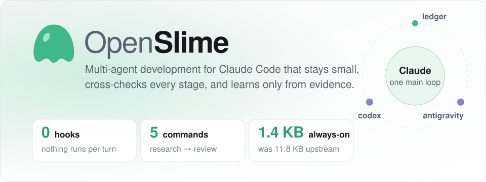
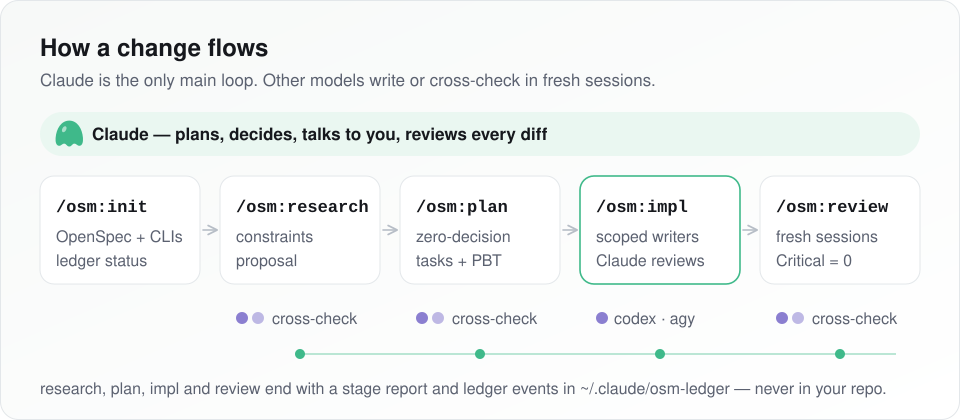
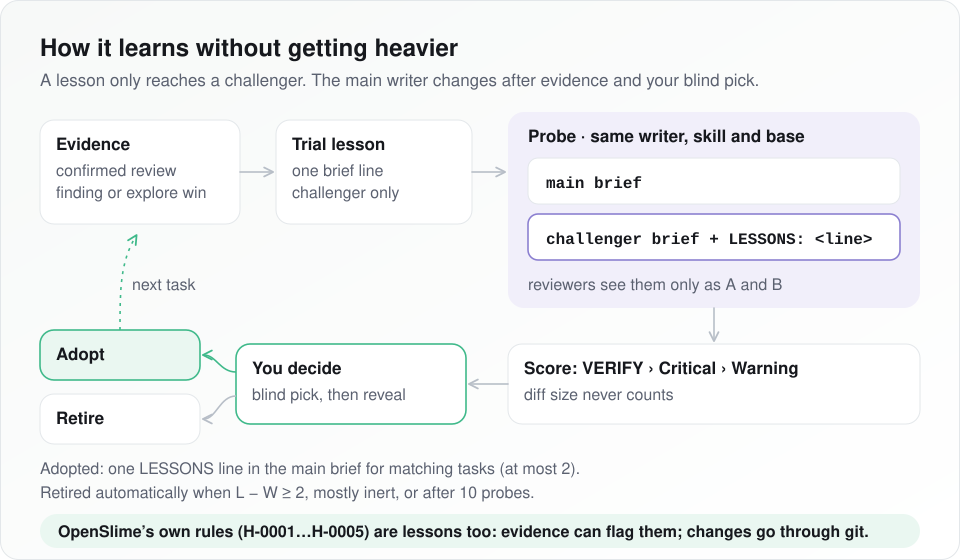
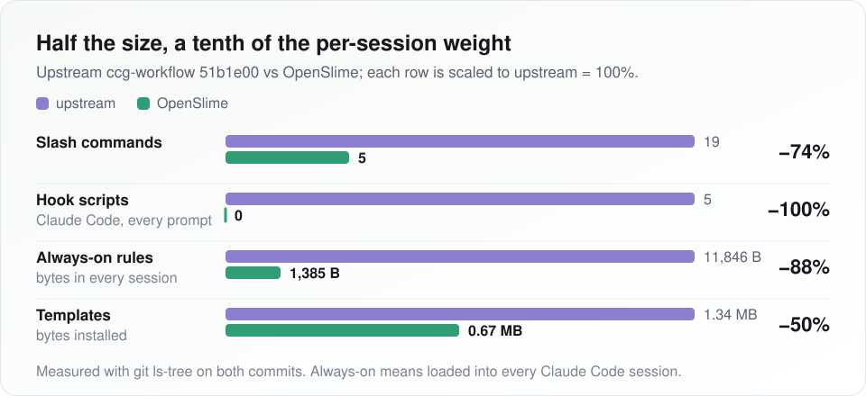

<p align="center">
  <picture>
    <source media="(prefers-color-scheme: dark)" srcset="assets/diagrams/hero-dark.svg">
    
  </picture>
</p>

<p align="center">
  
  
  
  
</p>

<p align="center"><sub><a href="README.md">English</a> &middot; 简体中文</sub></p>

---

## 安装

把下面这段发给你的 coding agent（Claude Code、Codex）：

```text
Install OpenSlime from https://github.com/Overbaker/OpenSlime. Follow AGENTS.md in that repo, then run its doctor check and tell me the result.
```

手动安装见 [AGENTS.md](AGENTS.md)。

## 五个命令

| 命令 | 作用 |
| --- | --- |
| `/osm:init` | 配置 OpenSpec，检查模型 CLI 和决策账本。 |
| `/osm:research` | 需求 &rarr; 约束集 + OpenSpec 提案。 |
| `/osm:plan` | 零决策计划：specs、design、`tasks.md`。 |
| `/osm:impl` | 把任务交给执行者写，Claude 审查 diff。 |
| `/osm:review` | 归档前，在独立会话里复审。 |

## 工作方式

<p align="center">
  <picture>
    <source media="(prefers-color-scheme: dark)" srcset="assets/diagrams/workflow-dark.svg">
    
  </picture>
</p>

- **限定范围的执行者。** `/osm:impl` 里 `codex` 写后端、逻辑和测试，`antigravity` 写 UI；每个任务都列出执行者可以改的文件。
- **Claude 监督。**
  - 不改变行为、不超过 5 行的机械问题，Claude 自己修，然后重跑 `VERIFY`。
  - 更大的改动通过 `resume` 退回给执行者。
  - 同一执行者失败两次后，先问你再决定是否接管。
- **始终交叉校验。** research、plan、review 都让 codex 和 antigravity 各自在新会话里独立完成，由 Claude 对比两者一致和分歧的地方。
- **阶段报告。** 每次运行结束都在 `${TMPDIR:-/tmp}/osm-reports/` 生成一份报告，附带置信度（高/中/低，百分比）。

## 决策账本与经验

<p align="center">
  <picture>
    <source media="(prefers-color-scheme: dark)" srcset="assets/diagrams/lesson-loop-dark.svg">
    
  </picture>
</p>

- **决策账本。** 每个阶段往 `~/.claude/osm-ledger/` 追加一行，记录这几样：
  - 该阶段给出的置信度；
  - 你做的决定；
  - 探测结果；
  - 之后的审查发现了什么。

  账本不进你的仓库，卸载时保留。不按轮次记录，没有 hook。
- **看账本不占上下文。** 在你自己的终端里运行下面两个命令：
  - `~/.claude/bin/osm ledger summary`：
    - 每个后端、每个 skill 的贡献度，结论是保留、待复查或证据不足；
    - 当时的置信度和后来实际结果的对比；
    - 你的选择有多少次采纳了 AI 推荐、推翻了推荐，或在 AI 介入后改了主意；
    - 如果你几乎总是直接接受，会给出橡皮图章提醒。
  - `~/.claude/bin/osm ledger summary --by-harness`：OpenSlime 自己的 prompt 或参数每改一次，就对比改动前后的上述数字。
- **经验（lesson），借鉴 [Harness²](https://github.com/google-research/harness2)，保持轻量。** 一条 lesson 就是给执行者 brief 加的一行，必须有证据支撑。
  - 试用期间只发给挑战者。挑战者和主执行者完全相同，只多这一行。
  - 两边结果以 A/B 形式盲审，按 VERIFY、Critical、Warning 的顺序判胜负，diff 大小不计分。
  - 只有经过你的盲选和揭晓，才会进入主 brief。
  - 表现差的 lesson 会自动退役。
- **OpenSlime 对自己同样适用。** 置信度公式、探测预算、采纳门槛、审查 prompt 都登记为已采纳的 lesson（`osm ledger harness`）。证据可以把它们标为待复查，修改要走正常的评审流程。
- **关闭账本：** `~/.claude/bin/osm ledger off`、`OSM_LEDGER=0` 或 `--no-ledger`。关闭后各阶段照常完成，置信度不变，lesson 和探测都会跳过。
- **探测需要已提交的代码。** 只有工作区除 `openspec/` 外是干净的，探测才会启动；否则记录为 `dirty-base` 跳过。
- **探测相关参数。**
  - `/osm:impl --compare`：强制做一次 lesson 探测。
  - `--compare explore`：保留旧的自选对比，结果不计入任何 lesson。
  - `--no-probe`：关闭探测。

## 为何轻量

<p align="center">
  <picture>
    <source media="(prefers-color-scheme: dark)" srcset="assets/diagrams/footprint-dark.svg">
    
  </picture>
</p>

| | 上游 `51b1e00` | OpenSlime |
| --- | ---: | ---: |
| 斜杠命令 | 19 | 5 |
| Claude Code hook 脚本 | 5 | 0 |
| 常驻规则 | 3 个文件，11,846 B | 1 个文件，1,385 B |
| 模板 | 260 个文件，1,338,837 B | 152 个文件，668,029 B |

<sub>用 `git ls-tree` 在上游 `51b1e00` 和本次变更之前的提交上测得。账本只新增一个按需读取的 prompt（`osm-ledger.md`），不新增任何常驻文本。</sub>

- **不做每轮注入。** 没有 hook，只有一个很小的常驻规则（`rules/ccg-codegraph.md`）。技能（`frontend-design`、`scrapling`、`seo-page-builder`、`bt-panel`、`adsense-site-auditor`）只在调用时加载。输出样式保留 Claude Code 内置的编码规范。
- **单一主循环。** Claude 负责规划、决策并与你对话，前面没有路由层。
- **外部模型只用在值得的地方：** 限定范围的编写，或者在新会话里给出第二意见。
  - 保留：Codex 主导模式（`node bin/ccg.mjs codex-mode install`），以及全部 wrapper 后端（`codex`、`claude`、`gemini`、`antigravity`、`grok`、`kimi`、`opencode`）。
  - 不支持：把 DeepSeek Harness 作为宿主。

设计原则见 [PRINCIPLES.md](PRINCIPLES.md)。

## 环境要求

- Node.js 20+、pnpm、git、Claude Code；
- 已登录的 `codex` 与 `agy`（Antigravity）CLI；
- OpenSpec：`npm i -g @fission-ai/openspec`，或者由 `/osm:init` 引导安装。

## 更新与卸载

```bash
# Update
cd ~/OpenSlime && git pull && pnpm install && pnpm build && node bin/ccg.mjs init --skip-prompt --skip-mcp --force

# Uninstall（保留 ~/.claude/osm-ledger）
cd ~/OpenSlime && node bin/ccg.mjs uninstall
```

## 致谢

OpenSlime 是 [fengshao1227/ccg-workflow](https://github.com/fengshao1227/ccg-workflow) 的精简 fork，移除了哪些部分、为什么移除，见 [FORK.md](FORK.md)。感谢上游贡献者，以及：

- [stellarlinkco/myclaude](https://github.com/stellarlinkco/myclaude)：`codeagent-wrapper`
- [DietrichGebert/ponytail](https://github.com/DietrichGebert/ponytail)：审查标准
- [ayghri/i-have-adhd](https://github.com/ayghri/i-have-adhd)：输出形态
- [google-research/harness2](https://github.com/google-research/harness2)：有证据支撑的 lesson 和对比探测的思路
- ace-tool

除 Harness²（Apache-2.0，只借鉴思路，未使用代码）以外均为 MIT 协议。OpenSlime 同样采用 [MIT](LICENSE)。
