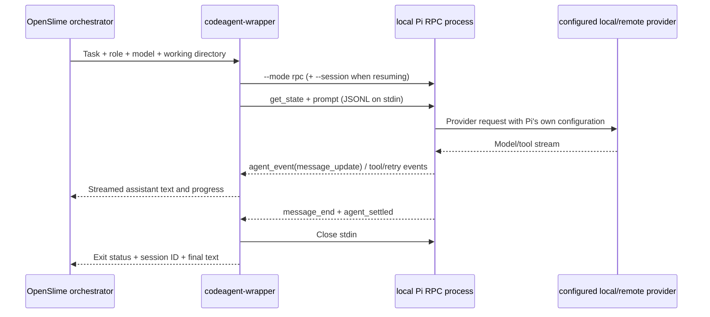

# Pi RPC backend

Pi is a first-class `codeagent-wrapper` backend. OpenSlime keeps its existing
orchestrator and worker boundary: it starts a **local Pi subprocess**, sends
protocol commands over stdin, and continuously reads structured events from stdout.
Pi owns model providers, provider credentials, tool permissions, and context-window
configuration. The provider can use a local model or a remote API. This integration
does **not** implement a connection to a separate remote Pi server.

## Configure Pi first

1. Install Pi on every machine running `codeagent-wrapper` and ensure `pi` is in
   `PATH`. On Windows, diagnostic checks use `pi.exe`.
2. Configure providers, models, and permissions using Pi configuration. Do not put
   API keys in OpenSlime config, workflow files, prompts, or logs.
3. Run `pi --list-models` to obtain a model ID or `provider/model` identifier.
4. In `osm init` or the model-routing menu, select **Pi (RPC)**. Enter the exact
   model identifier, or leave it empty to inherit Pi's current default.

To use a 1M context, select the model variant that actually has a 1M context window,
and retain any required provider/model configuration in Pi. For example:

```toml
# ~/.claude/.ccg/config.toml
[routing]
primary = "claude"

[routing.backend]
primary = "pi"
models = ["pi"]

# An example only: use an identifier from your own `pi --list-models`.
piModel = "your-provider/your-1m-model"
```

OpenSlime does not detect, resize, truncate, or override the provider's context
window. A model name containing `1m` alone is not proof of its capability. Check
Pi's provider configuration and usage limits, including reasoning-token limits.
If the selected model is unavailable or authentication fails, the task fails with
Pi's provider error; OpenSlime does not silently switch models.

## Invocation

```bash
# New session. Use the installed wrapper (normally ~/.claude/bin).
codeagent-wrapper --lite --backend pi \
  --pi-model your-provider/your-1m-model \
  'Inspect the current change and report regressions. Do not modify files.' \
  /path/to/project

# Multiline and @-prefixed prompts are protocol data, not Pi @file references.
codeagent-wrapper --lite --backend pi - /path/to/project <<'EOF'
Review the referenced diff.
@literal-text must remain literal.

Return the requested JSON structure.
EOF

# Reuse the SESSION_ID returned by the first invocation.
codeagent-wrapper --lite --backend pi \
  resume <session_id> 'Continue with the requested change.' /path/to/project
```

`PI_MODEL` supplies the default model; `--pi-model`/`--pi-model=<value>` overrides it.
Injected workflows use `{{PI_MODEL_FLAG}}` only on Pi calls. In parallel-input mode,
backend-specific model flags are not accepted; set `PI_MODEL` before invoking the
wrapper. The task field can specify `backend: "pi"` (or `pi` without JSON syntax).
`CODEAGENT_PI_COMMAND` can select a Pi executable for testing or a custom install.

## Protocol and lifecycle



- `get_state` discovers the session ID. Saved IDs are treated as resumable session
  identifiers, not as proof that an RPC request has completed.
- Prompt acceptance (`response` for `prompt`) is not completion. The wrapper reads
  until `agent_settled` while streaming assistant `text_delta` events.
- A final assistant message supplies the result; an empty result is an error. stdin
  is closed on settlement, timeout, or cancellation so the long-lived RPC process
  can terminate. Timeout/interrupt cleanup uses existing process-group handling.
- RPC command rejections, exhausted provider retries, provider errors, assistant
  `error`/`aborted` stop reasons, and protocol read failures become nonzero results.
  A transport EOF cannot conceal a previously reported protocol error.
- New sessions consume context normally. A resumed session opens an existing Pi
  session and adds the new prompt; it incurs the provider's actual session/context
  costs rather than starting an independent free context.

For predictable delegated tasks, Pi starts with `--no-extensions`, `--no-skills`, and
`--no-prompt-templates`. This avoids interactive extension approval and unrelated
project behavior. MCP is disabled by default; `--with-mcp` is the explicit opt-in.
These flags restrict the subprocess configuration, not the provider's safety policy.
Read-only prompts do not replace OS/filesystem permissions, and `--lite` controls
OpenSlime's auxiliary Web UI, not Pi's provider or context window.

## Output and errors

Successful output retains the final `SESSION_ID: <id>` marker used by existing
resume workflows. Stderr contains structured process diagnostics and optional
progress. Provider failures, invalid model IDs, missing executables, timeouts, and
cancelled work are errors, not successful empty responses.

Use `pi --mode rpc` directly only when debugging Pi itself. Do not put an interactive
`exit` command into delegated task input or rely on Pi's terminal renderer; consume
the JSON events instead. `osm doctor --json` checks the Pi executable when Pi is
routed and reports executable failure without collecting provider credentials.
